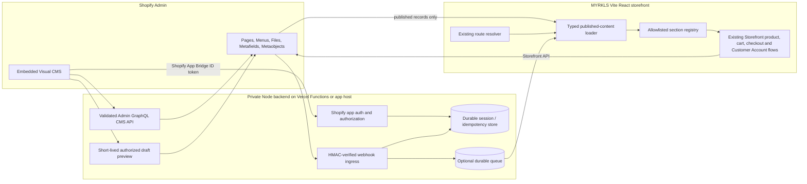
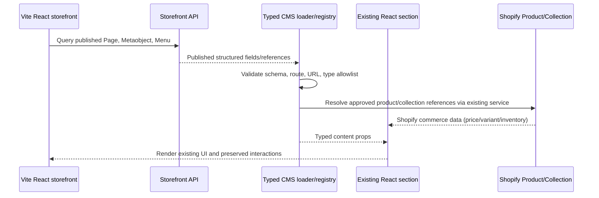

# MYRKLS CMS Phase 1 — Proposed Architecture

**Status:** Architecture proposal only. No app, API, Shopify definition or application code is created by this document.  
**Design invariant:** Shopify stays the commerce source of truth; the React/Vite storefront and its tested Storefront/cart/account integrations remain in place.

## 1. Goals and boundaries

1. Let authorized merchants manage approved presentation content and page composition from Shopify Admin.
2. Reuse MYRKLS components and design system; avoid replacing the storefront or Shopify commerce paths.
3. Keep Admin access, drafts, publishing and preview behind a server-side authenticated boundary.
4. Allow the public storefront to read only published public content using the existing Storefront API client and typed models.
5. Render only a code-defined, typed allowlist. Shopify content may select an allowed section and provide validated data; it may never supply code, component names to dynamic imports, script, stylesheets or executable templates.
6. Ship incrementally with a static/current-content fallback and feature flag per surface. A CMS content failure must not break product price/availability/cart/checkout or customer identity.

## 2. Recommended system

- **Storefront:** Existing Vite/React 18 SPA on Vercel. Extend `src/shopify/content/` and add a page-content adapter, typed discriminated unions and a section registry. Keep `src/shopify/services/products.ts`, `collections.ts`, `cart.ts`, Customer Account services, route behavior and existing analytics dependencies intact.
- **Content authoring:** A custom embedded Shopify Admin app is appropriate for the requested visual page builder, reusable sections, preview and publishing UX. Start with Shopify native Admin Pages, Menus, Files, product/collection resources, metafields and merchant-owned Metaobjects; use the Admin API only when the editor needs controlled reads/writes or drafts not available publicly. A custom visual builder is an app UI—not an arbitrary Liquid/code editor.
- **Public content:** Published Metaobjects with storefront read access and native Page/Menu/Metafield data are read with Storefront API 2026-10 by the browser. The already-existing public GraphQL client can be reused. Do not send Admin credentials or private draft data to the browser.
- **Backend:** A Node-compatible private app backend authenticates Shopify Admin app requests, validates authorization and inputs, calls Admin GraphQL, manages sessions and handles preview/webhooks. Vercel Functions can be sufficient for short request/response work if paired with durable external session/idempotency storage and a queue for background work; the current static Vercel project has no `/api` functions or such storage. Do not mistake static hosting or the public Storefront client for an Admin backend.
- **Preview:** Draft preview must be fetched through an authenticated backend. The backend returns a narrowly scoped, short-lived, signed preview payload/URL or renders an authorized preview response. Never publish drafts to PUBLIC_READ just to preview them. Recheck user/shop access on every preview request; expire and revoke preview grants.
- **Source of truth:** CMS controls page composition and editorial fields only. Product/variant titles, prices, compare-at prices, inventory, availability, IDs and checkout URL remain Shopify commerce data. Cart/customer/order/payment state is never stored in CMS entries.

### Proposed architecture diagram

The diagram's `AdminData` label is conceptual: public commerce and CMS content queries use Storefront API scopes, while Admin writes use server-held Admin app access tokens and Admin API scopes. The browser never calls the Admin API directly.

## 3. Shopify resource strategy

| Requirement | Prefer | Reason / boundary |
|---|---|---|
| Products, variants, stock, price, compare-at price, product images | Native Product/Variant/Inventory data; Storefront API reads | Existing live commerce source. Do not duplicate these fields in CMS. |
| Collection membership/title/image/description/SEO | Native Collection; collection metafield only for supplemental editorial layout/reference | Keep collection product set and ordering/prices as Shopify commerce/catalog behavior. |
| Individual custom fields attached to a Product or Collection | Typed metafields | Shopify documents metafields as resource-attached custom fields; use only for one-off editorial data/refs that belong to that resource. |
| Reusable structured editorial records: hero, FAQ, story, trust badge, section configuration | Metaobject definitions/entries | A Metaobject is a reusable typed multi-field record. Restrict its fields and reference types; enable public read only for published public content. |
| Simple public informational pages and stable handles | Native Shopify Pages, with Shopify native SEO | Native Page has title, handle, body, SEO and metafields; protect legal page content via owner review. Use structured Page fields/section refs for visual layout rather than arbitrary HTML. |
| Navigation hierarchy | Shopify native Menus | Storefront Menu supports nested links to products, collections, pages/blogs and URLs. Keep behavior (mobile menu, dropdown, keyboard interactions) in React. |
| Images/files | Shopify Files and typed `file_reference` fields | Keeps media in Shopify CDN; preserve alt text and image transformations. Video/file host must be allowlisted. |
| Page templates and ordered sections | Metaobjects referenced from Page/resource metafields, with `cms_template` and allowlisted section types | Explicit typed relationships and deterministic order. Do not make a theme/Liquid template executable input. |
| Draft/publish | Native Shopify Page publication; Metaobject publishable capability where applicable | Distinguish publication state from a visual `visible` boolean. Storefront reads published records; app preview uses Admin authorization. |
| Private app config and tokens | App installation/session storage outside public Storefront content | Never use `VITE_` for Admin tokens/secrets. Avoid publishing private config as public Metaobject. |

Use merchant-owned Metaobjects for content the merchant should retain/use independently of this app; app-owned Metaobjects are appropriate for app-private configuration/schema control but can make content ownership/portability different. Decide with the store owner before defining any type.

## 4. Admin app, authentication and authorization

### Embedded app request flow

1. Register an app and fixed HTTPS URLs/allowed redirects with Shopify; define least-privilege scopes before installation.
2. Embedded UI loads in Admin using Shopify App Bridge. For each backend request, obtain the short-lived ID token, send it over HTTPS, and validate signature, `aud`, `iss`, `dest`, `exp`, `nbf` and shop/user context server-side. The token authenticates the Admin user/request; it is not an Admin API token.
3. Resolve the shop installation/session from durable server-side storage, enforce installation, shop and authorized staff access, and use the server-held app access token for Admin GraphQL.
4. Use authorization-code OAuth/session-token exchange per the currently selected Shopify app template and token model. Follow Shopify's maintained app library where possible; avoid hand-rolled OAuth/cookie assumptions. Secure same-site cookies and CSRF protection are needed for any cookie-authenticated route.
5. Re-authorize each mutation by shop, CMS role and permitted record/page. Enforce schema-derived allowlists and field-level validation server-side; never trust a button being hidden in React.

Suggested CMS roles: read-only preview; editor (edit unpublished content); publisher (publish/unpublish); owner/admin (settings/schema/roles). Shopify staff/app scopes and application roles are separate checks. The store owner decides staff-role policy.

### Minimum scope planning (confirm against actual GraphQL operations and Shopify review)

- Read public published content via Storefront access with `unauthenticated_read_metaobjects`; native Pages/Menus require `unauthenticated_read_content` as applicable.
- Admin app content CRUD: only the specific read/write Metaobject and definition scopes needed; Page/metafield/menu/file scopes only if the feature really edits them. Avoid product/order/customer write scopes for a CMS.
- Product/Collection may need read-only Admin access only if an Admin CMS screen needs validation/selection beyond native references. Public storefront rendering should continue to read those via Storefront API.
- No order, payment, fulfillment or Customer Account scopes are needed for page-building. Do not add them to the CMS app.
- Record scope rationale in the app manifest and run a post-change least-privilege review before installation.

Scope names and access rules can evolve; verify exact version/scopes in Shopify Admin GraphQL 2026-10 before app registration. Never request customer PII scopes just to personalize website copy.

## 5. Backend and hosting trade-offs

### Option A — Vercel serverless functions (recommended initial fit if operational needs stay small)

Pros: same Vercel project/domain/deployment workflow; short CMS CRUD, OAuth callbacks, secure API and preview handlers fit request/response functions; fewer services. Requirements: Node runtime, Shopify app configuration/redirects, durable external database for offline sessions and idempotency, external queue/storage if deferred processing is needed, strict request/body/time limits, and Preview/Production secret separation. The current repository has no `/api` folder, durable store, Shopify app manifest or server function, so this is new infrastructure—not already available.

Cons: functions are not persistent workers; timeouts/cold starts and deployment-bound secrets complicate bulk operations, long media workflows and sustained webhooks. Never rely on in-memory sessions, locks, caches or dedup records between invocations. Keep webhook acknowledgment fast after durable enqueue; retry processing from a queue.

### Option B — Separate persistent Node app/service

Pros: clearer boundary and separate release lifecycle for CMS/Shopify Admin integration; persistent worker/queue and scheduled jobs fit larger media/publish workflows. Cons: additional hosting, DNS, monitoring, access controls, deployment and operational ownership. Requires CORS/domain and secure communication with Vercel storefront/embedded admin.

**Recommendation:** begin with Vercel Node Functions plus managed durable storage/queue only if tested provider limits, Shopify OAuth callback, webhook delivery, session security and operational monitoring satisfy requirements. Otherwise host the backend on a Shopify-app-oriented Node platform and keep the Vite storefront on Vercel. Decide before CMS-3; no backend choice was implemented here.

## 6. React rendering and content flow

1. Existing `resolveAppRoute` identifies existing canonical route type/handle.
2. A route-specific content loader fetches only published Page/template/Metaobject data with the configured locale/market context; cache key includes shop, route, locale and publication/version identity.
3. A strict runtime parser validates IDs, expected Metaobject type, required fields, references, safe relative or HTTPS CTA URLs, color tokens, image alt, schedule and list limits.
4. A registry maps a discriminated `component_type` to an imported, already compiled component. Unknown or invalid content is skipped with explicit telemetry/fallback; never use `eval`, `dangerouslySetInnerHTML` for arbitrary merchant input, dynamic code imports or arbitrary CSS from Shopify.
5. Section component receives typed content presentation data plus a separately fetched Shopify product/collection model. It receives existing navigation/cart callbacks; it does not own commerce persistence or invent price/availability.
6. Preserve current hero static fallback and brand layout during staged migration. For dynamic page CMS failure, render the last approved known content or an explicit safe error/empty state. Do not substitute static product prices when configured Shopify commerce fails.

### Proposed rendering sequence

## 7. Cache, webhook and preview approach

- **Public content:** use short bounded in-memory request dedup/cache already present in `src/shopify/graphql-client.ts`; later add a CDN/ISR or deployment-cache strategy only after architecture selection. Cache entries must be immutable published content and keyed by locale/market. A page cache must not mix a draft or another shop.
- **Invalidation:** Admin writes should return an updated public revision; Shopify webhooks should invalidate affected page/metaobject/template/media cache keys. Events can be duplicated/reordered. Verify `X-Shopify-Hmac-SHA256` over the raw body in constant-time, validate shop/topic, use `X-Shopify-Webhook-Id` idempotency and durable persistence, acknowledge quickly after enqueue, and process retries safely.
- **Preview:** short-lived, signed, scoped to shop and record/page/preview revision; no reusable Admin token in URL. Disable indexing and third-party marketing pixels for private draft routes. Revoke/expire tokens, prevent open redirects and do not cache draft HTML publicly.
- **Draft safety:** public Storefront can fetch only permitted published content; Admin GraphQL handles unpublished/draft reads under staff/app authorization. Do not set public storefront read access to expose draft data.

## 8. Existing integration compatibility matrix

| Existing functionality | Current implementation | CMS interaction | Must remain unchanged? | Risk | Recommended approach |
|---|---|---|---|---|---|
| Product catalog | `MyrklsProductGrid`, `MyrklsShopifyCatalogPage`, Product services | CMS may choose featured product references, labels and presentation options. | Yes—Storefront is product truth. | CMS IDs may point to deleted/unpublished items. | Resolve references through existing Product service; omit invalid records; never synthesize commerce fields. |
| Product detail | `MyrklsProductDetailPage` | CMS may provide page template/editorial section refs. | Yes—product handle/price/availability/variants are Shopify data. | Duplicated descriptions or prices become stale. | Native product record wins; CMS only adds separate editorial layout/copy. |
| Search | `MyrklsSearchModal`, catalog/search service | At most copy/empty-state configuration. | Yes. | CMS search filtering changes relevance or leaks bad links. | Keep current Storefront query and safe navigation. |
| Collections | Catalog route and collection service | CMS may select banner/layout via collection metafield. | Yes—membership/products stay Shopify. | Template reference unavailable or mismatched. | Safe default current collection grid. |
| Product variants | PDP and cart services | No variant/price editing in CMS. | Absolutely. | Stale duplicate variant reference. | Use returned Shopify variant IDs and availability only. |
| Cart | `MyrklsCartContext`, `services/cart.ts` | None beyond safe merchandising text or CTA label. | Absolutely. | CMS section action accidentally bypasses cart validation. | Use existing callbacks/context; all cart data remains remote Shopify response. |
| Cart drawer | `MyrklsCartDrawer.tsx` | No layout replacement during CMS-1; future CMS only theme tokens if approved. | Yes. | Regression/accessibility risk. | Keep component and modal/keyboard semantics; test every cart action after any later change. |
| Checkout | `CheckoutRoute`, cart drawer redirect | CMS cannot supply/construct checkout URL or success state. | Absolutely. | Open redirect/fake order confirmation. | Existing validated fresh Shopify checkout URL and explicit redirect remain code-only. |
| Customer accounts | Customer Account OAuth/context/page | No CMS writes or custom authentication UI in this route. | Absolutely. | Draft preview/session collision; PII. | Keep identity/account service separate; test ownership/session expiry. |
| Customer order history | Customer Account service | No CMS access. | Absolutely. | PII exposure. | Customer-scoped API only; no order copies in content records. |
| Routing | `src/routing/routes.ts`, `App.tsx`, Vercel rewrites | CMS could add allowlisted custom Page handles later. | Preserve existing routes/aliases. | Route takeover, duplicate handles, 404/indexation. | Collision checks, explicit resolver, static known routes first; route migration tested. |
| SEO | `MyrklsSEO`, `src/seo/metadata.ts`, sitemap | CMS can edit approved Page SEO and editorial metadata. | Existing canonical/JSON-LD safety preserved. | Client-only metadata; arbitrary canonical/noindex. | Native SEO where possible; allowlisted route metadata; SSR/prerender remains a separate decision. |
| Analytics | `src/analytics/`, consent provider | Section events can be code-bound to registered section IDs. | Consent and event contracts remain code-controlled. | Draft/preview events, duplicate conversions, PII. | Disable/mark preview; reuse consent-aware functions; validate identifiers. |
| Payment integration | Shopify hosted checkout; provider unknown | No CMS control. | Absolutely. | Misleading payment messaging. | Owner verifies provider/test-mode; content cannot claim unsupported payment methods. |
| Shipping integration | Shopify checkout/store settings, not Admin-verified | CMS may display only owner-approved explanatory text. | Absolutely. | False rates/coverage/delivery promises. | No hardcoded shipping values; checkout is authoritative. |
| Third-party scripts/video | Deferred science video and consent-gated analytics; CSP | CMS may reference approved media URLs only. | Execution/privacy behavior stays code-controlled. | XSS, CSP breakage, consent bypass, tracking injection. | File/media domain allowlist; never accept script/embed HTML; consent-gated runtime. |
| Vercel deployment | Static `dist`, rewrites/headers in `vercel.json` | CMS backend may add Node API routes and envs. | Keep storefront deployment path. | Current no API/session store; domain config unresolved. | Introduce backend separately with Preview verification and durable state; no deploy without authorization. |

## 9. Decision gates before CMS-2

- Owner confirms intended Shopify store, production domain and checkout/password state. Current production-domain probe is inconsistent and must be investigated.
- Owner reviews/repairs contaminated product description and approves the valid source copy/media/reviews/legal content.
- Owner decides merchant-owned vs app-owned Metaobject ownership, native Page usage, section reorder/deletion permissions, localization/Markets, roles, versioning/rollback, and preview UX.
- Choose Vercel Functions plus durable storage/queue or a separate Node app host; identify monitoring/incident owner.
- Confirm app registration, callback domains, staff permissions and exact least-privilege scopes.
- Select storefront publication/fallback and cache invalidation design.
- Obtain owner approval before creating any Shopify schema/resource or deploying an Admin app.

## 10. Verified Shopify references

Documentation consulted for Shopify API version 2026-10/capabilities on 2026-11-16:

- [About Metaobjects](https://shopify.dev/docs/apps/build/metaobjects) — structured reusable data, definitions, ownership and capabilities.
- [MetaobjectDefinition — Admin GraphQL 2026-10](https://shopify.dev/docs/api/admin-graphql/2026-10/objects/MetaobjectDefinition) — definition fields/access/capabilities.
- [Metaobject — Storefront API 2026-10](https://shopify.dev/docs/api/storefront/2026-10/objects/Metaobject) — `unauthenticated_read_metaobjects`, public fields and renderable/online-store capability behavior.
- [About metafields](https://shopify.dev/docs/apps/build/metafields) — resource-attached typed custom fields vs standalone Metaobjects.
- [Page — Storefront API 2026-10](https://shopify.dev/docs/api/storefront/2026-10/objects/Page) — native Page fields, SEO, metafields and `unauthenticated_read_content`.
- [Menu — Storefront API 2026-10](https://shopify.dev/docs/api/storefront/2026-10/objects/Menu) — hierarchical native navigation and supported linked resources.
- [ID tokens for embedded apps](https://shopify.dev/docs/apps/build/authentication-authorization/id-tokens) — short-lived token flow and server validation requirements.
- [Verify webhook deliveries](https://shopify.dev/docs/apps/build/webhooks/verify-deliveries) — raw-body HMAC and duplicate delivery IDs.
